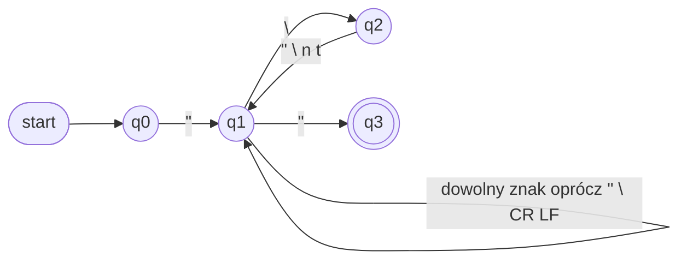
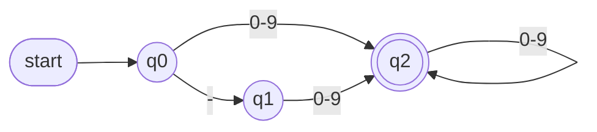
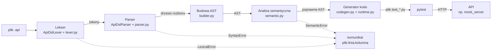
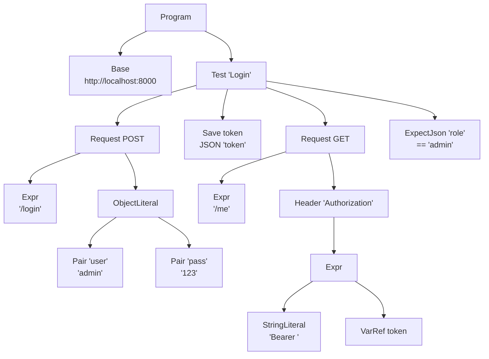

# apidsl — dokumentacja kompilatora

Projekt na przedmiot **Języki formalne i kompilatory**.
Temat: *Testowanie API i przechodzenie po endpointach*.

## Spis treści

1. [Opis języka](#1-opis-języka)
2. [Gramatyka formalna G = (N, T, P, S)](#2-gramatyka-formalna-g--n-t-p-s)
3. [Analiza leksykalna: tokeny, wyrażenia regularne, automaty](#3-analiza-leksykalna)
4. [Gramatyka w notacji EBNF](#4-gramatyka-w-notacji-ebnf)
5. [Zbiory FIRST i FOLLOW — dowód, że gramatyka jest LL(1)](#5-zbiory-first-i-follow--dowód-że-gramatyka-jest-ll1)
6. [Analiza semantyczna](#6-analiza-semantyczna)
7. [Budowa kompilatora i przykład kompilacji](#7-budowa-kompilatora-i-przykład-kompilacji)
8. [Testy](#8-testy)

---

## 1. Opis języka

**apidsl** to dziedzinowy język programowania (DSL) służący do opisywania testów API
działających po protokole HTTP. Program składa się z opcjonalnego adresu bazowego (`BASE`)
oraz co najmniej jednego testu (`TEST`). Test to ciąg instrukcji wykonywanych po kolei:

| Instrukcja | Znaczenie |
|---|---|
| `GET`, `POST`, `PUT`, `DELETE` | wysłanie zapytania HTTP; opcjonalnie z ciałem `BODY { ... }` i nagłówkami `HEADER` |
| `EXPECT STATUS n` | sprawdzenie kodu odpowiedzi |
| `EXPECT JSON "ścieżka" == wartość` | sprawdzenie wartości w odpowiedzi JSON |
| `SAVE zmienna = JSON "ścieżka"` | zapamiętanie wartości z odpowiedzi w zmiennej |

Dzięki instrukcji `SAVE` wynik jednego zapytania może zostać użyty w kolejnym — na tym polega
*przechodzenie po endpointach* (np. logowanie → token → zapytanie z tokenem).

```
BASE "http://localhost:8000";

TEST "Login flow" {
    POST "/login" BODY { "user": "admin", "pass": "123" };
    EXPECT STATUS 200;
    SAVE token = JSON "token";

    GET "/me" HEADER "Authorization" = "Bearer " + token;
    EXPECT STATUS 200;
    EXPECT JSON "role" == "admin";
}
```

Kompilator tłumaczy program na plik w języku Python z testami dla biblioteki **pytest**.
Każdy `TEST` staje się osobną funkcją testową.

---

## 2. Gramatyka formalna G = (N, T, P, S)

Gramatyka jest bezkontekstowa: **G = (N, T, P, S)**. Poniższa postać (BNF) powstała
z gramatyki EBNF (rozdział 4) przez zastąpienie:

- elementu opcjonalnego `[ x ]` nowym nieterminalem `XOpt → x | ε`,
- powtórzenia `{ x }` nowym nieterminalem z rekursją **prawostronną** `XList → x XList | ε`.

Dzięki temu gramatyka nie zawiera rekursji lewostronnej, co jest warunkiem koniecznym
analizy zstępującej.

### 2.1. Symbol startowy S

**S = Program**

### 2.2. Zbiór terminali T (26 symboli)

Terminalami są tokeny zwracane przez lekser (szczegóły w rozdziale 3).

| Grupa | Terminale |
|---|---|
| Słowa kluczowe (15) | `TEST`, `BASE`, `GET`, `POST`, `PUT`, `DELETE`, `EXPECT`, `STATUS`, `JSON`, `SAVE`, `BODY`, `HEADER`, `true`, `false`, `null` |
| Tokeny z wartością (3) | `IDENT` (identyfikator), `NUMBER` (liczba całkowita), `STRING` (napis) |
| Symbole (8) | `{`, `}`, `;`, `:`, `,`, `+`, `=`, `==` |

W zbiorach FOLLOW używany jest dodatkowo znacznik końca wejścia **$** (token `EOF`),
który nie należy do T.

### 2.3. Zbiór nieterminali N (23 symbole)

`Program`, `BaseOpt`, `Base`, `TestList`, `Test`, `StatementList`, `Statement`, `Request`,
`Method`, `BodyOpt`, `HeaderList`, `Header`, `Assertion`, `AssertionTail`, `Save`, `Expr`,
`ExprTail`, `Term`, `Object`, `PairsOpt`, `PairList`, `Pair`, `Value`

### 2.4. Zbiór produkcji P (44 produkcje)

```
 1  Program       → BaseOpt Test TestList
 2  BaseOpt       → Base
 3  BaseOpt       → ε
 4  Base          → BASE STRING ;
 5  TestList      → Test TestList
 6  TestList      → ε
 7  Test          → TEST STRING { StatementList }
 8  StatementList → Statement StatementList
 9  StatementList → ε
10  Statement     → Request
11  Statement     → Assertion
12  Statement     → Save
13  Request       → Method Expr BodyOpt HeaderList ;
14  Method        → GET
15  Method        → POST
16  Method        → PUT
17  Method        → DELETE
18  BodyOpt       → BODY Object
19  BodyOpt       → ε
20  HeaderList    → Header HeaderList
21  HeaderList    → ε
22  Header        → HEADER STRING = Expr
23  Assertion     → EXPECT AssertionTail ;
24  AssertionTail → STATUS NUMBER
25  AssertionTail → JSON STRING == Value
26  Save          → SAVE IDENT = JSON STRING ;
27  Expr          → Term ExprTail
28  ExprTail      → + Term ExprTail
29  ExprTail      → ε
30  Term          → STRING
31  Term          → IDENT
32  Object        → { PairsOpt }
33  PairsOpt      → Pair PairList
34  PairsOpt      → ε
35  PairList      → , Pair PairList
36  PairList      → ε
37  Pair          → STRING : Value
38  Value         → STRING
39  Value         → NUMBER
40  Value         → IDENT
41  Value         → Object
42  Value         → true
43  Value         → false
44  Value         → null
```

---

## 3. Analiza leksykalna

Lekser jest generowany przez **ANTLR 4.13.2** z reguł leksykalnych w pliku
[`grammar/ApiDsl.g4`](../grammar/ApiDsl.g4). Nakładka [`apidsl/lexer.py`](../apidsl/lexer.py)
zamienia błędy ANTLR na własne komunikaty i dekoduje sekwencje ucieczki w napisach.
Każdy token ma typ, tekst, wartość oraz pozycję: **numer linii i kolumny** (liczone od 1).

### 3.1. Tabela tokenów

| Token | Wyrażenie regularne | Wartość | Przykład |
|---|---|---|---|
| `TEST`, `BASE`, `GET`, `POST`, `PUT`, `DELETE`, `EXPECT`, `STATUS`, `JSON`, `SAVE`, `BODY`, `HEADER` | dokładnie dane słowo, np. `TEST` | tekst | `EXPECT` |
| `TRUE`, `FALSE`, `NULL` | `true`, `false`, `null` | tekst | `true` |
| `IDENT` | `[a-zA-Z_][a-zA-Z0-9_]*` | tekst | `user_id2` |
| `NUMBER` | `-?[0-9]+` | liczba całkowita | `-5`, `200` |
| `STRING` | `"([^"\\\r\n] \| \\["\\nt])*"` | napis bez cudzysłowów, ze zdekodowanymi sekwencjami | `"Bearer "` |
| `LBRACE` | `\{` | | `{` |
| `RBRACE` | `\}` | | `}` |
| `SEMI` | `;` | | `;` |
| `COLON` | `:` | | `:` |
| `COMMA` | `,` | | `,` |
| `PLUS` | `\+` | | `+` |
| `EQ` | `==` | | `==` |
| `ASSIGN` | `=` | | `=` |
| *(pomijany)* biały znak | `[ \t\r\n]+` | | |
| *(pomijany)* komentarz | `#[^\r\n]*` | | `# komentarz` |

Dozwolone sekwencje ucieczki w napisach: `\"`, `\\`, `\n`, `\t`.

### 3.2. Rozstrzyganie niejednoznaczności

1. **Najdłuższe dopasowanie** — lekser wybiera najdłuższy możliwy token. Dlatego `==` jest
   jednym tokenem `EQ`, a nie dwoma `ASSIGN`; `TESTS` to `IDENT`, a nie `TEST` + `S`.
2. **Priorytet reguł** — przy równej długości wygrywa reguła zdefiniowana wcześniej.
   Słowa kluczowe są zdefiniowane przed `IDENT`, więc `TEST` jest słowem kluczowym.
3. **Wielkość liter ma znaczenie** — `test`, `Test` i `TRUE` są identyfikatorami.

### 3.3. Błędy leksykalne

| Sytuacja | Komunikat | Pozycja |
|---|---|---|
| napis bez zamykającego `"` (koniec linii lub pliku) | `unterminated string` | otwierający `"` |
| niedozwolona sekwencja ucieczki, np. `\q` | `invalid escape sequence '\q'` | znak `\` |
| znak spoza alfabetu, np. `@`, `ż`, samotny `-` | `unexpected character '@'` | ten znak |

Szczegół implementacyjny: reguła ANTLR dla `STRING` akceptuje `\` z dowolnym znakiem,
a poprawność sekwencji jest sprawdzana zaraz po analizie leksykalnej. Język akceptowanych
napisów jest taki sam jak w tabeli 3.1, ale komunikat błędu wskazuje dokładnie błędną sekwencję.

### 3.4. Automat skończony (DFA) dla tokenu STRING

Stany: **q0** — początek, **q1** — wewnątrz napisu, **q2** — po znaku `\`,
**q3** — stan akceptujący (napis zamknięty).



Tabela przejść (brak przejścia oznacza błąd leksykalny):

| Stan | `"` | `\` | `n`, `t` | CR, LF, koniec pliku | inny znak |
|---|---|---|---|---|---|
| → q0 | q1 | — | — | — | — |
| q1 | **q3** | q2 | q1 | błąd: `unterminated string` | q1 |
| q2 | q1 | q1 | q1 | błąd: `unterminated string` | błąd: `invalid escape sequence` |
| **q3** (akceptujący) | — | — | — | — | — |

### 3.5. Automat skończony (DFA) dla tokenu NUMBER

Stany: **q0** — początek, **q1** — po znaku minus, **q2** — stan akceptujący (co najmniej
jedna cyfra).



| Stan | `-` | `0`–`9` | inny znak |
|---|---|---|---|
| → q0 | q1 | q2 | — |
| q1 | — | q2 | błąd: `unexpected character '-'` |
| **q2** (akceptujący) | koniec tokenu | q2 | koniec tokenu |

Ze względu na zasadę najdłuższego dopasowania `123abc` daje dwa tokeny: `NUMBER(123)`
i `IDENT(abc)`. Taki ciąg zostanie odrzucony dopiero przez parser.

---

## 4. Gramatyka w notacji EBNF

Notacja zgodna z ISO/IEC 14977: `,` — konkatenacja, `|` — alternatywa,
`[ ]` — element opcjonalny, `{ }` — powtórzenie zero lub więcej razy.

```ebnf
program   = [ base ], test, { test } ;
base      = "BASE", STRING, ";" ;
test      = "TEST", STRING, "{", { statement }, "}" ;
statement = request | assertion | save ;
request   = method, expr, [ "BODY", object ], { header }, ";" ;
method    = "GET" | "POST" | "PUT" | "DELETE" ;
header    = "HEADER", STRING, "=", expr ;
assertion = "EXPECT", ( "STATUS", NUMBER | "JSON", STRING, "==", value ), ";" ;
save      = "SAVE", IDENT, "=", "JSON", STRING, ";" ;
expr      = term, { "+", term } ;
term      = STRING | IDENT ;
object    = "{", [ pair, { ",", pair } ], "}" ;
pair      = STRING, ":", value ;
value     = STRING | NUMBER | IDENT | object | "true" | "false" | "null" ;
```

Ta sama gramatyka w składni ANTLR znajduje się w pliku
[`grammar/ApiDsl.g4`](../grammar/ApiDsl.g4); reguły parsera odpowiadają regułom EBNF jeden
do jednego (`[ x ]` → `x?`, `{ x }` → `x*`).

---

## 5. Zbiory FIRST i FOLLOW — dowód, że gramatyka jest LL(1)

### 5.1. Definicje

- **FIRST(α)** — zbiór terminali, od których może zaczynać się słowo wyprowadzalne z α
  (oraz ε, jeśli α ⇒* ε).
- **FOLLOW(A)** — zbiór terminali, które mogą wystąpić bezpośrednio po nieterminalu A
  w jakiejś formie zdaniowej (oraz $, jeśli A może kończyć wejście).
- **SELECT(A → α)** = FIRST(α) \ {ε}, a jeśli α ⇒* ε, to dodatkowo ∪ FOLLOW(A).

Gramatyka jest **LL(1)** wtedy i tylko wtedy, gdy dla każdego nieterminala A zbiory SELECT
wszystkich jego produkcji są parami rozłączne.

### 5.2. Tabela FIRST i FOLLOW

| Nieterminal | FIRST | FOLLOW |
|---|---|---|
| Program | `BASE` `TEST` | $ |
| BaseOpt | `BASE` ε | `TEST` |
| Base | `BASE` | `TEST` |
| TestList | `TEST` ε | $ |
| Test | `TEST` | `TEST` $ |
| StatementList | `GET` `POST` `PUT` `DELETE` `EXPECT` `SAVE` ε | `}` |
| Statement | `GET` `POST` `PUT` `DELETE` `EXPECT` `SAVE` | `GET` `POST` `PUT` `DELETE` `EXPECT` `SAVE` `}` |
| Request | `GET` `POST` `PUT` `DELETE` | `GET` `POST` `PUT` `DELETE` `EXPECT` `SAVE` `}` |
| Method | `GET` `POST` `PUT` `DELETE` | `STRING` `IDENT` |
| BodyOpt | `BODY` ε | `HEADER` `;` |
| HeaderList | `HEADER` ε | `;` |
| Header | `HEADER` | `HEADER` `;` |
| Assertion | `EXPECT` | `GET` `POST` `PUT` `DELETE` `EXPECT` `SAVE` `}` |
| AssertionTail | `STATUS` `JSON` | `;` |
| Save | `SAVE` | `GET` `POST` `PUT` `DELETE` `EXPECT` `SAVE` `}` |
| Expr | `STRING` `IDENT` | `BODY` `HEADER` `;` |
| ExprTail | `+` ε | `BODY` `HEADER` `;` |
| Term | `STRING` `IDENT` | `+` `BODY` `HEADER` `;` |
| Object | `{` | `HEADER` `;` `,` `}` |
| PairsOpt | `STRING` ε | `}` |
| PairList | `,` ε | `}` |
| Pair | `STRING` | `,` `}` |
| Value | `STRING` `NUMBER` `IDENT` `{` `true` `false` `null` | `;` `,` `}` |

### 5.3. Zbiory SELECT (tablica analizy predykcyjnej)

Poniższa tabela to w skróconej postaci tablica parsera LL(1): dla nieterminala na wierzchu
stosu i bieżącego tokenu wybierana jest ta produkcja, której zbiór SELECT zawiera token.

| Nr | Produkcja | SELECT |
|---|---|---|
| 1 | Program → BaseOpt Test TestList | `BASE` `TEST` |
| 2 | BaseOpt → Base | `BASE` |
| 3 | BaseOpt → ε | `TEST` |
| 4 | Base → BASE STRING ; | `BASE` |
| 5 | TestList → Test TestList | `TEST` |
| 6 | TestList → ε | $ |
| 7 | Test → TEST STRING { StatementList } | `TEST` |
| 8 | StatementList → Statement StatementList | `GET` `POST` `PUT` `DELETE` `EXPECT` `SAVE` |
| 9 | StatementList → ε | `}` |
| 10 | Statement → Request | `GET` `POST` `PUT` `DELETE` |
| 11 | Statement → Assertion | `EXPECT` |
| 12 | Statement → Save | `SAVE` |
| 13 | Request → Method Expr BodyOpt HeaderList ; | `GET` `POST` `PUT` `DELETE` |
| 14–17 | Method → GET \| POST \| PUT \| DELETE | odpowiednio `GET`, `POST`, `PUT`, `DELETE` |
| 18 | BodyOpt → BODY Object | `BODY` |
| 19 | BodyOpt → ε | `HEADER` `;` |
| 20 | HeaderList → Header HeaderList | `HEADER` |
| 21 | HeaderList → ε | `;` |
| 22 | Header → HEADER STRING = Expr | `HEADER` |
| 23 | Assertion → EXPECT AssertionTail ; | `EXPECT` |
| 24 | AssertionTail → STATUS NUMBER | `STATUS` |
| 25 | AssertionTail → JSON STRING == Value | `JSON` |
| 26 | Save → SAVE IDENT = JSON STRING ; | `SAVE` |
| 27 | Expr → Term ExprTail | `STRING` `IDENT` |
| 28 | ExprTail → + Term ExprTail | `+` |
| 29 | ExprTail → ε | `BODY` `HEADER` `;` |
| 30 | Term → STRING | `STRING` |
| 31 | Term → IDENT | `IDENT` |
| 32 | Object → { PairsOpt } | `{` |
| 33 | PairsOpt → Pair PairList | `STRING` |
| 34 | PairsOpt → ε | `}` |
| 35 | PairList → , Pair PairList | `,` |
| 36 | PairList → ε | `}` |
| 37 | Pair → STRING : Value | `STRING` |
| 38–44 | Value → STRING \| NUMBER \| IDENT \| Object \| true \| false \| null | odpowiednio `STRING`, `NUMBER`, `IDENT`, `{`, `true`, `false`, `null` |

### 5.4. Sprawdzenie warunku LL(1)

**Nieterminale z produkcją pustą (ε)** — zbiór FIRST produkcji niepustej musi być rozłączny
z FOLLOW nieterminala:

| Nieterminal | SELECT produkcji niepustej | SELECT produkcji ε (= FOLLOW) | Część wspólna |
|---|---|---|---|
| BaseOpt | `BASE` | `TEST` | ∅ |
| TestList | `TEST` | $ | ∅ |
| StatementList | `GET` `POST` `PUT` `DELETE` `EXPECT` `SAVE` | `}` | ∅ |
| BodyOpt | `BODY` | `HEADER` `;` | ∅ |
| HeaderList | `HEADER` | `;` | ∅ |
| ExprTail | `+` | `BODY` `HEADER` `;` | ∅ |
| PairsOpt | `STRING` | `}` | ∅ |
| PairList | `,` | `}` | ∅ |

**Nieterminale z kilkoma produkcjami niepustymi** — zbiory FIRST alternatyw muszą być
rozłączne:

| Nieterminal | Zbiory FIRST alternatyw | Rozłączne? |
|---|---|---|
| Statement | {`GET` `POST` `PUT` `DELETE`}, {`EXPECT`}, {`SAVE`} | tak |
| Method | {`GET`}, {`POST`}, {`PUT`}, {`DELETE`} | tak |
| AssertionTail | {`STATUS`}, {`JSON`} | tak |
| Term | {`STRING`}, {`IDENT`} | tak |
| Value | {`STRING`}, {`NUMBER`}, {`IDENT`}, {`{`}, {`true`}, {`false`}, {`null`} | tak |

Pozostałe nieterminale mają po jednej produkcji. Wszystkie warunki są spełnione,
a gramatyka nie zawiera rekursji lewostronnej, zatem **gramatyka G jest klasy LL(1)**:
do wyboru produkcji zawsze wystarcza jeden token podglądu.

Zbiory zostały policzone ręcznie i sprawdzone programem, który iteracyjnie wyznacza FIRST,
FOLLOW i SELECT dla produkcji z punktu 2.4 (wynik: brak konfliktów).

### 5.5. Związek z parserem ANTLR

ANTLR generuje parser **zstępujący rekurencyjnie** (*recursive descent*): w pliku
`apidsl/generated/ApiDslParser.py` każda reguła gramatyki ma własną metodę (`program()`,
`request()`, `value()` itd.). ANTLR używa strategii ALL(*), która obsługuje także gramatyki
spoza LL(1), ale dla naszej gramatyki każda decyzja zapada po jednym tokenie podglądu.

Zbiory z tego rozdziału widać bezpośrednio w komunikatach błędów. Dla programu
`GET "/users"` bez średnika parser zgłasza:

```
syntax.api:5:5: SyntaxError: expected one of 'BODY', 'HEADER', ';', got 'EXPECT'
```

Lista oczekiwanych tokenów to dokładnie SELECT produkcji 18 i 19 (`BODY` ∪ FOLLOW(BodyOpt)).
Token `+` też byłby w tym miejscu poprawny (produkcja 28), ale parser zgłasza zbiór z punktu
decyzji, w którym wykrył błąd — już po zakończeniu wyrażenia `Expr`.

---

## 6. Analiza semantyczna

Analizator ([`apidsl/semantic.py`](../apidsl/semantic.py)) przechodzi po drzewie AST
i sprawdza reguły, których nie da się wyrazić gramatyką bezkontekstową.

### 6.1. Tablica symboli i zasięg zmiennych

- Każdy `TEST` ma **własną tablicę symboli** (`SymbolTable`) — zmienne mają zasięg testu.
- Instrukcja `SAVE x = JSON "..."` **definiuje** zmienną `x` (zapisuje nazwę i pozycję).
- Każde **użycie** zmiennej (w adresie, nagłówku, ciele zapytania lub w wartości oczekiwanej
  `EXPECT JSON`) jest sprawdzane w tablicy symboli bieżącego testu.
- Instrukcje są analizowane w kolejności wykonania, więc zmienna musi być zdefiniowana
  **przed** użyciem.

### 6.2. Reguły semantyczne

| Reguła | Komunikat | Pozycja błędu |
|---|---|---|
| Zmienna użyta przed `SAVE` (lub zapisana w innym teście) | `variable 'token' is used before SAVE` | użycie zmiennej |
| `EXPECT` / `SAVE` przed pierwszym zapytaniem w teście | `EXPECT STATUS before any request in test 'X'` | instrukcja |
| Powtórzona nazwa testu | `duplicate test name 'X' (first defined at line 1)` | drugi i kolejne testy |
| Kod statusu spoza zakresu 100–599 | `status code 700 is outside 100-599` | instrukcja `EXPECT STATUS` |
| Ścieżka względna (`"/..."`) bez `BASE` | `relative path '/users' requires BASE` | adres zapytania |
| Pusty test | `test 'X' is empty` | `TEST` |

Decyzje projektowe:

- **Zbierane są wszystkie błędy**, a nie tylko pierwszy; są sortowane według pozycji w pliku.
- `SAVE` przed pierwszym zapytaniem jest błędem, ale **i tak definiuje zmienną** — dzięki temu
  jeden błąd nie powoduje lawiny kolejnych komunikatów.
- Regułę ścieżki względnej sprawdza się tylko, gdy adres zaczyna się od napisu.
  Jeśli zaczyna się od zmiennej (`GET host + "/x"`), jej wartość nie jest znana w czasie
  kompilacji.
- Wielkość liter w nazwach testów ma znaczenie (`"Login"` i `"login"` to różne testy).

Przykład:

```
TEST "Semantic errors" {
    EXPECT STATUS 200;
    GET "/users/" + user_id;
    EXPECT STATUS 700;
}

TEST "Semantic errors" {
}
```

```
semantic.api:2:5: SemanticError: EXPECT STATUS before any request in test 'Semantic errors'
semantic.api:3:9: SemanticError: relative path '/users/' requires BASE
semantic.api:3:21: SemanticError: variable 'user_id' is used before SAVE
semantic.api:4:5: SemanticError: status code 700 is outside 100-599
semantic.api:7:1: SemanticError: duplicate test name 'Semantic errors' (first defined at line 1)
semantic.api:7:1: SemanticError: test 'Semantic errors' is empty
```

### 6.3. Semantyka wykonania

| Element | Znaczenie w czasie działania testu |
|---|---|
| zapytanie | wysyłane biblioteką `requests` z limitem czasu `timeout=10` s; ciało `BODY` jako JSON |
| `EXPECT` / `SAVE` | dotyczą **ostatniej odpowiedzi** w tym samym teście |
| ścieżka JSON | klucze rozdzielone kropką; segment liczbowy indeksuje listę: `"items.0.id"` |
| adres | jeśli zaczyna się od `/` i jest `BASE`, to `BASE` + adres; w przeciwnym razie bez zmian |
| `+` | konkatenacja napisów; wartość zmiennej, która nie jest napisem, zamieniana jest na tekst JSON (`7` → `"7"`, `true` → `"true"`) |
| zmienna w `BODY` | zachowuje typ JSON (liczba pozostaje liczbą) |
| `==` w `EXPECT JSON` | porównanie wartości JSON; `true` nie jest równe `1` |
| niepowodzenie | `AssertionError` z numerem linii w pliku `.api`, np. `line 9: expected JSON "role" == "guest", got "admin"` |

---

## 7. Budowa kompilatora i przykład kompilacji

### 7.1. Schemat działania



| Etap | Moduł | Wejście → wyjście |
|---|---|---|
| Analiza leksykalna | `apidsl/generated/ApiDslLexer.py` (ANTLR), `apidsl/lexer.py` | tekst → tokeny |
| Analiza składniowa | `apidsl/generated/ApiDslParser.py` (ANTLR), `apidsl/parser.py` | tokeny → drzewo rozbioru |
| Budowa AST | `apidsl/builder.py` (visitor), `apidsl/ast.py` (węzły) | drzewo rozbioru → AST |
| Analiza semantyczna | `apidsl/semantic.py` | AST → lista błędów |
| Generowanie kodu | `apidsl/codegen.py`, `apidsl/runtime.py` | AST → kod Python |
| Interfejs | `apidsl/cli.py`, `apidsl/compiler.py`, `apidsl/printer.py` | polecenia `compile` i `run` |

**Obsługa błędów.** Błędy leksykalne i składniowe zatrzymują kompilację na pierwszym błędzie;
błędy semantyczne są zbierane wszystkie. Każdy błąd ma format
`plik.api:linia:kolumna: Rodzaj: komunikat`. Kody wyjścia programu: `0` — sukces,
`1` — błędy kompilacji lub niezaliczone testy, `2` — błąd użycia (np. brak pliku).

**Bezpieczeństwo generowanego kodu.** Wszystkie wartości z programu (napisy, klucze, ścieżki)
trafiają do kodu Python jako literały utworzone funkcją `ascii()` — nigdy przez sklejanie
tekstu. Zmienne z programu dostają przedrostek `var_`, więc nie kolidują ze słowami
kluczowymi Pythona. Testy jednostkowe sprawdzają, że nawet napisy zawierające cudzysłowy,
`"""`, nawiasy klamrowe czy kod Pythona pozostają zwykłymi danymi.

### 7.2. Przykład: od kodu źródłowego do Pythona

**Kod źródłowy** (`przyklad.api`):

```
BASE "http://localhost:8000";

TEST "Login" {
    POST "/login" BODY { "user": "admin", "pass": "123" };
    SAVE token = JSON "token";
    GET "/me" HEADER "Authorization" = "Bearer " + token;
    EXPECT JSON "role" == "admin";
}
```

**Krok 1 — tokeny** (`python -m apidsl compile przyklad.api --tokens`):

```
1:1     BASE        BASE
1:6     STRING      "http://localhost:8000"
1:29    SEMI        ;
3:1     TEST        TEST
3:6     STRING      "Login"
3:14    LBRACE      {
4:5     POST        POST
4:10    STRING      "/login"
4:19    BODY        BODY
4:24    LBRACE      {
4:26    STRING      "user"
4:32    COLON       :
4:34    STRING      "admin"
4:41    COMMA       ,
4:43    STRING      "pass"
4:49    COLON       :
4:51    STRING      "123"
4:57    RBRACE      }
4:58    SEMI        ;
5:5     SAVE        SAVE
5:10    IDENT       token
5:16    ASSIGN      =
5:18    JSON        JSON
5:23    STRING      "token"
5:30    SEMI        ;
6:5     GET         GET
6:9     STRING      "/me"
6:15    HEADER      HEADER
6:22    STRING      "Authorization"
6:38    ASSIGN      =
6:40    STRING      "Bearer "
6:50    PLUS        +
6:52    IDENT       token
6:57    SEMI        ;
7:5     EXPECT      EXPECT
7:12    JSON        JSON
7:17    STRING      "role"
7:24    EQ          ==
7:27    STRING      "admin"
7:34    SEMI        ;
8:1     RBRACE      }
9:1     EOF
```

**Krok 2 — drzewo AST** (`python -m apidsl compile przyklad.api --ast`):

```
Program @1:1
  base: Base url='http://localhost:8000' @1:1
  tests: Test name='Login' @3:1
    statements: Request method=POST @4:5
      url: Expr @4:10
        parts: StringLiteral value='/login' @4:10
      body: ObjectLiteral @4:24
        pairs: Pair key='user' @4:26
          value: StringLiteral value='admin' @4:34
        pairs: Pair key='pass' @4:43
          value: StringLiteral value='123' @4:51
    statements: Save name='token' path='token' @5:5
    statements: Request method=GET @6:5
      url: Expr @6:9
        parts: StringLiteral value='/me' @6:9
      headers: Header name='Authorization' @6:15
        value: Expr @6:40
          parts: StringLiteral value='Bearer ' @6:40
          parts: VarRef name='token' @6:52
    statements: ExpectJson path='role' @7:5
      expected: StringLiteral value='admin' @7:27
```

To samo drzewo w postaci graficznej:



Drzewo AST jest znacznie mniejsze niż drzewo rozbioru ANTLR (widoczne we wtyczce
*ANTLR Preview*): nie zawiera średników, nawiasów ani dwukropków — tylko znaczenie programu.

**Krok 3 — analiza semantyczna**: zmienna `token` jest zdefiniowana (linia 5) przed użyciem
(linia 6), `SAVE` i `EXPECT` występują po zapytaniu, jest `BASE` — brak błędów.

**Krok 4 — wygenerowany kod** (`python -m apidsl compile przyklad.api`; pominięto dołączone
funkcje pomocnicze z `runtime.py`):

```python
# Generated by apidsl from 'przyklad.api'. Do not edit.
BASE = 'http://localhost:8000'


def test_login():
    response = send('POST', resolve_url(BASE, '/login'), 4, body={'user': 'admin', 'pass': '123'})
    var_token = json_path(response, 'token', 5)
    response = send('GET', resolve_url(BASE, '/me'), 6, headers={'Authorization': 'Bearer ' + text(var_token)})
    expect_json(response, 'role', 'admin', 7)
```

Liczby `4`, `5`, `6`, `7` to numery linii w pliku `.api` — trafiają do komunikatów
o niepowodzeniu testu.

**Krok 5 — uruchomienie** (`python -m mock_server`, a w drugim terminalu
`python -m apidsl run przyklad.api`):

```
test_przyklad.py::test_login PASSED
1 passed
```

---

## 8. Testy

Każdy etap kompilatora ma własne testy jednostkowe (`python -m pytest`, łącznie 250 testów):

| Plik | Liczba | Co sprawdza |
|---|---|---|
| `tests/test_lexer.py` | 69 | tokeny, słowa kluczowe, napisy i sekwencje ucieczki, pozycje, błędy leksykalne |
| `tests/test_syntax.py` | 23 | poprawne programy i komunikaty błędów składniowych |
| `tests/test_ast.py` | 26 | budowa drzewa AST, wszystkie rodzaje wartości, pozycje węzłów |
| `tests/test_semantic.py` | 34 | wszystkie reguły semantyczne, zasięg zmiennych, zbieranie wielu błędów |
| `tests/test_codegen.py` | 17 | wygenerowany kod: zapytania, typy wartości, nazwy funkcji, bezpieczeństwo literałów |
| `tests/test_runtime.py` | 37 | funkcje pomocnicze: ścieżki JSON, porównania, komunikaty, `timeout=10` |
| `tests/test_cli.py` | 15 | polecenia `compile` i `run`, `--tokens`, `--ast`, format błędów, kody wyjścia |
| `tests/test_mock_server.py` | 17 | endpointy serwera testowego |
| `tests/test_examples.py` | 10 | przykłady z `examples/` oraz pełne uruchomienie (`run`) na serwerze testowym |
| `tests/test_errors.py` | 2 | format komunikatu błędu |

Testy nie korzystają z internetu — testy end-to-end łączą się wyłącznie z lokalnym
serwerem testowym uruchamianym na losowym porcie.
